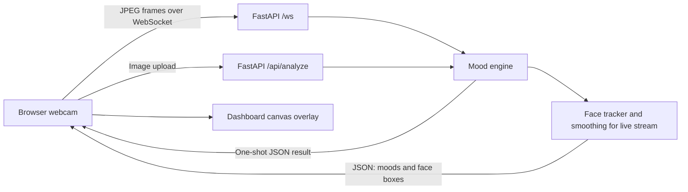

# MoodLens

Real-time face mood detection, right in your browser. MoodLens streams webcam frames to a FastAPI backend over a WebSocket, analyzes faces with computer vision, then sends mood estimates and bounding boxes back to a live dashboard. The result is an interactive, end-to-end demo: start the camera and watch face overlays, mood scores, and session stats update as frames arrive.

> Mood labels are estimates produced by computer vision models. They can be inaccurate and should not be used to make decisions about people.

## Contents

- [Features](#features)
- [Stack](#stack)
- [How it works](#how-it-works)
- [Requirements](#requirements)
- [Run locally](#run-locally)
- [Run with Docker](#run-with-docker)
- [Mood engines](#mood-engines)
- [HTTP and WebSocket API](#http-and-websocket-api)
- [Configuration](#configuration)
- [Development and tests](#development-and-tests)
- [Project structure](#project-structure)
- [Deployment notes](#deployment-notes)

## Features

- **Live camera view:** mood-coloured corner brackets track detected faces as the stream runs.
- **At-a-glance mood dashboard:** a large emoji readout, seven-bar mood meter, timeline chart, latency and frame rate, and session stats make each session easy to follow.
- **Flexible inputs:** analyze a live webcam feed, upload an image for one-off analysis, or save a snapshot with the overlay.
- **Two engines, one interface:** use the lightweight Haar engine for happy/neutral estimates, or install DeepFace for all seven categories: happy, sad, angry, surprise, fear, disgust, and neutral.
- **Steadier live results:** face tracking keeps IDs more consistent, while score smoothing helps reduce flicker between frames.
- **Ready-to-use backend:** REST and WebSocket endpoints, interactive Swagger documentation at `/docs`, Docker and Compose configuration, and a pytest suite.
- **Easy to tune:** environment variables control the engine, frame sizing, smoothing, tracking lifetime, and analysis rate limits.

MoodLens brings the camera, inference pipeline, and visualization together in one small application, with no frontend build step. Run it locally or in Docker, switch engines from the dashboard, and inspect the same analysis pipeline through the API.

## Stack

The backend is built with **Python, FastAPI, OpenCV, and NumPy**. FastAPI serves the dashboard, accepts still-image uploads, and streams live results over WebSockets. OpenCV handles image decoding and Haar detection; the optional DeepFace integration adds a seven-category mood model.

The frontend uses **plain HTML, CSS, and JavaScript**—no framework, package install, or build step. It captures and downsizes webcam frames, draws face overlays on canvas, and renders the mood meter, timeline, and session stats directly in the browser.

## How it works



The browser captures and downsizes webcam frames before sending them. The backend decodes each image, runs the selected engine, and returns detected faces with mood scores. Live results pass through a tracker to reduce identity changes and visual flicker. Uploaded images are analyzed once without tracking or smoothing.

## Requirements

- Python 3.10 or newer (the Docker image uses Python 3.12)
- A modern browser for webcam access
- Docker and Docker Compose, if using the container setup

The optional DeepFace engine has additional machine-learning dependencies and downloads model data on first use.

## Run locally

Create a virtual environment and install the base dependencies:

```bash
python -m venv .venv
```

Activate it, then install the requirements:

```bash
# macOS / Linux
source .venv/bin/activate

# Windows PowerShell
.venv\Scripts\Activate.ps1

pip install -r requirements.txt
```

Start the application from the repository root:

```bash
uvicorn backend.app.main:app --reload
```

Open [http://localhost:8000](http://localhost:8000). Webcam access is available on `localhost` or over HTTPS. Browsers generally block camera access on a plain HTTP connection from another device on your LAN.

## Run with Docker

Build and start the default Haar setup:

```bash
docker compose up --build
```

Then open [http://localhost:8000](http://localhost:8000). The Compose file publishes port `8000` and sets `MOODLENS_ENGINE=haar`.

To include DeepFace in the image, set the `DEEPFACE` build argument to `"1"` in `docker-compose.yml`, and set `MOODLENS_ENGINE` to `deepface` if you want it selected by default. The DeepFace image is substantially larger.

## Mood engines

| Engine | Mood categories | Dependencies | Notes |
| --- | --- | --- | --- |
| `haar` (default) | `happy`, `neutral` | Included in base requirements | Uses OpenCV Haar cascades for face and smile detection. The mood output is a smile-based approximation. |
| `deepface` | `happy`, `sad`, `angry`, `surprise`, `fear`, `disgust`, `neutral` | `requirements-deepface.txt` | Uses DeepFace for emotion analysis. Model initialization can make the first analysis slow. |

Install the optional dependencies with:

```bash
pip install -r requirements-deepface.txt
```

Choose an engine in the dashboard, or set `MOODLENS_ENGINE` before starting the server. The API reports whether DeepFace is installed at `GET /api/engines`.

## HTTP and WebSocket API

Interactive API documentation is available at [http://localhost:8000/docs](http://localhost:8000/docs).

### `GET /api/health`

Returns a basic health status and the configured default engine.

### `GET /api/engines`

Lists the available engines, whether each is installed, its mood categories, and the configured default.

### `POST /api/analyze`

Analyzes an uploaded image. Submit a multipart form field named `file`; optionally choose an engine with the `engine` query parameter.

```bash
curl -F "file=@photo.jpg" "http://localhost:8000/api/analyze?engine=haar"
```

The response includes the image dimensions, selected engine, inference latency, and detected faces. Each face contains a bounding box, mood, confidence, and mood scores.

### `WS /ws`

Send binary JPEG frames to receive JSON results with `type: "result"`. Frames above the configured rate are skipped with a `{ "type": "rate_limited" }` response; the connection stays open and the client can continue streaming. Text messages control the session:

```json
{"engine":"deepface"}
```

```json
{"reset":true}
```

Changing engines resets the face tracker. Malformed image frames are ignored. If the client exceeds the configured frame rate, the server skips excess frames and keeps the connection open.

## Configuration

Set these environment variables before starting the server:

| Variable | Default | Description |
| --- | --- | --- |
| `MOODLENS_ENGINE` | `haar` | Default engine (`haar` or `deepface`). |
| `MOODLENS_MAX_WIDTH` | `640` | Maximum frame width sent to the detection engine; larger frames are resized. |
| `MOODLENS_ALPHA` | `0.45` | Smoothing weight for new tracker scores and box positions. |
| `MOODLENS_TRACK_TTL` | `1.5` | Seconds without a match before a face track expires. |
| `MOODLENS_ANALYZE_RATE_LIMIT` | `30` | Maximum upload-analysis requests per client during the configured window. |
| `MOODLENS_ANALYZE_RATE_WINDOW` | `60` | Upload-analysis rate-limit window in seconds. |
| `MOODLENS_WS_FRAME_RATE_LIMIT` | `10` | Maximum WebSocket frames per client during the configured window. |
| `MOODLENS_WS_FRAME_RATE_WINDOW` | `1` | WebSocket frame rate-limit window in seconds. |

The rate limits use the connecting client IP and are stored in memory per server process. The upload endpoint responds with HTTP `429` and a `Retry-After` header when limited. If running behind a reverse proxy, configure trusted proxy handling so the application receives the correct client address; do not trust arbitrary forwarded headers.

## Development and tests

Install the development requirements:

```bash
pip install -r requirements-dev.txt
```

Run the test suite from the repository root:

```bash
pytest
```

The tests cover health and engine endpoints, static file serving, image analysis error handling, WebSocket behavior, and face tracker behavior.

## Project structure

```text
backend/app/
  main.py       FastAPI routes, image processing, and WebSocket stream
  engines.py    Haar and optional DeepFace mood engines
  tracker.py    Face association and score smoothing
  config.py     Environment-based configuration
  rate_limit.py In-memory sliding-window rate limiter
frontend/
  index.html    Dashboard markup
  app.js       Webcam, upload, WebSocket, and dashboard behavior
  style.css    Dashboard styles
tests/
  test_api.py   API and tracker tests
legacy_smile_cli.py  Original standalone OpenCV smile detector
```

## Deployment notes

- The included rate limiter is per process and in-memory. For multiple workers or replicas, use a shared rate-limit store or enforce limits at a trusted reverse proxy.
- The application does not include authentication. Restrict access appropriately before exposing it to untrusted networks.
- Webcam access requires a secure browser context (`localhost` or HTTPS).
- DeepFace model startup and inference can require significant CPU, memory, and disk space.
- Face mood estimates can be wrong and may vary with lighting, pose, camera quality, and the model used.
